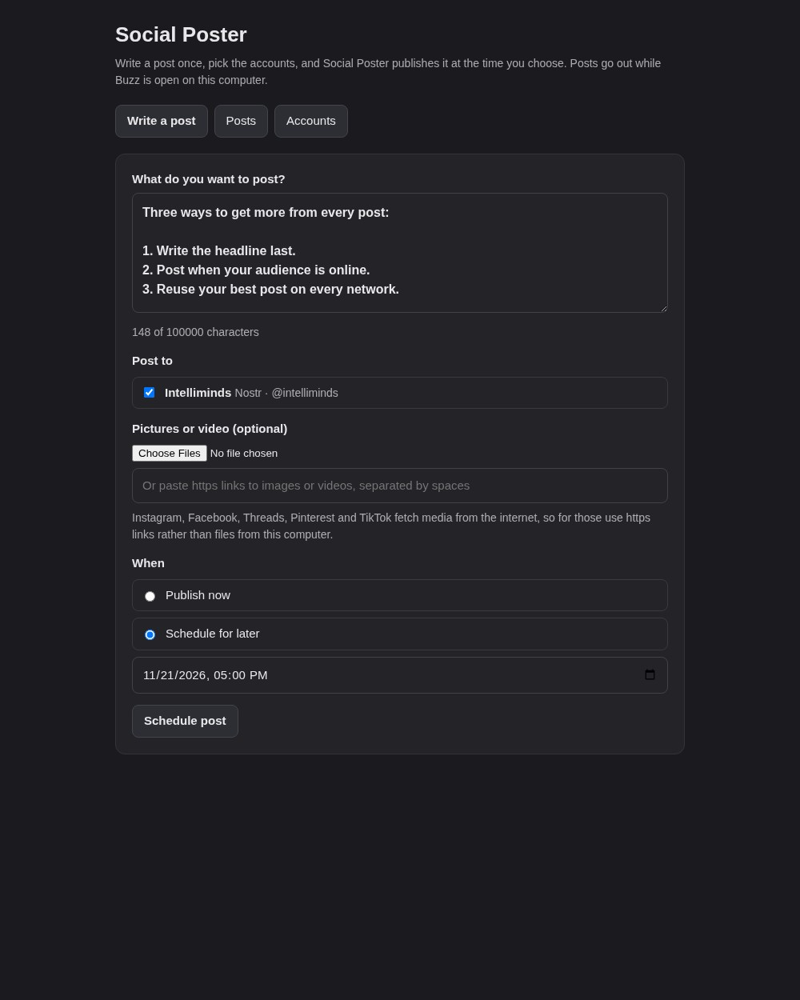
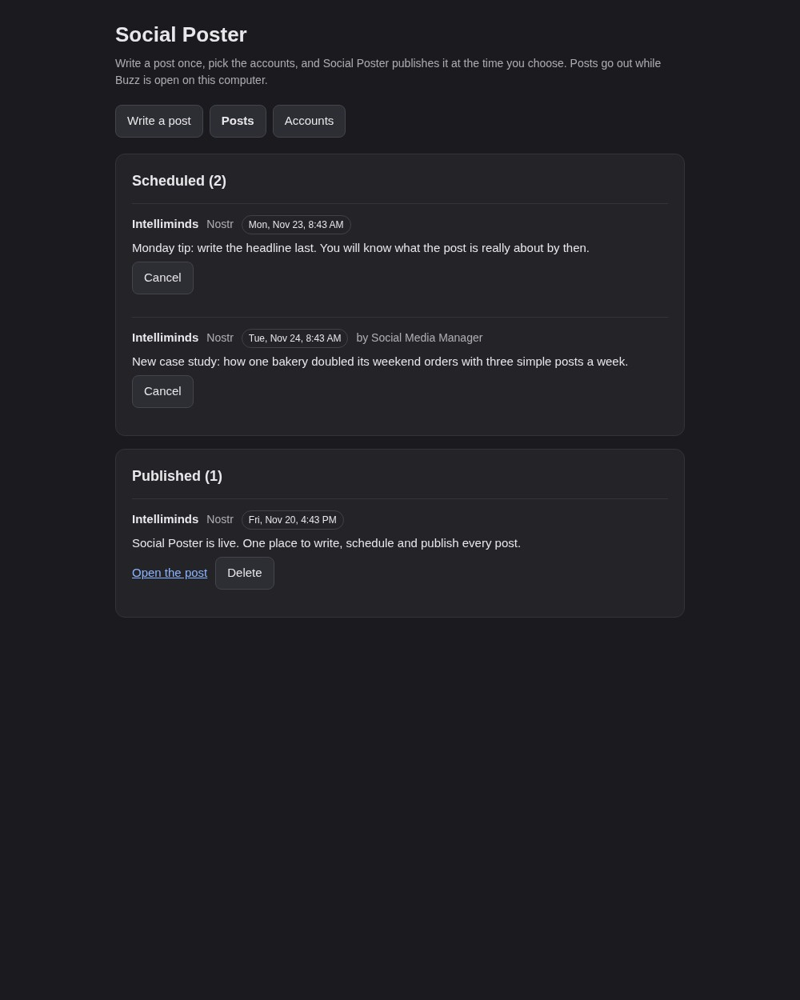
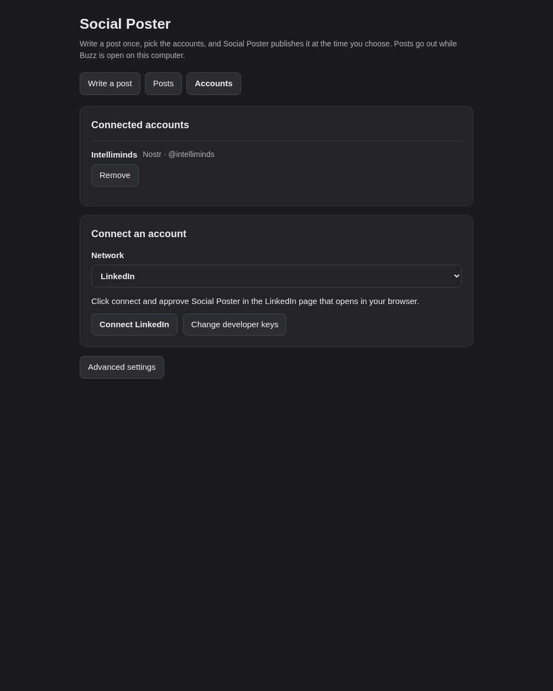

# Social Poster

Write a post once, pick the accounts, and Social Poster publishes it now or at the time you choose. It works with 34 networks, including X, LinkedIn, Instagram, Facebook, Threads, YouTube, TikTok, Pinterest, Reddit, Bluesky, Mastodon, Discord, Slack, Telegram and WordPress.

It runs the open-source [Postiz](https://github.com/gitroomhq/postiz-app) connectors on your own computer. You don't need Docker, a database server or hosting.

## Install

You need Node.js 22.5 or newer and git. Tested on Linux with Node 26.

1. Clone this repo, then build Social Poster once:
   ```sh
   git clone https://github.com/Lucas10-ctrl/Buzz-plugins.git
   cd Buzz-plugins/social-poster
   node build.mjs
   ```
   This downloads the Postiz source at a pinned commit and bundles its connectors. It also installs two commands in `~/.local/bin`: `social-poster-engine` and `social-poster`.
2. In Buzz, open **Settings → Plugins → Manage plugins**, choose **Add**, then **Browse**, and pick this `social-poster` folder. Review the access it asks for (it starts `social-poster-engine` on your computer) and choose **Install plugin**.
3. Open **Social Poster** in the sidebar.

## Use it

| Write a post | Posts | Accounts |
| --- | --- | --- |
|  |  |  |


- **Accounts:** pick a network and connect it. Most networks first need a free developer app that you create once. The page shows the steps and the exact callback address to paste. Bluesky, Nostr, Lemmy, Medium, Dev.to, Hashnode, WordPress and ListMonk only need your login details.
- **Write a post:** type the post, tick the accounts, add pictures or video if you want, then publish now or schedule it.
- **Posts:** see what's scheduled, published (with links) or failed (with the reason). From here you can cancel, post again or delete.

## For agents

- Buzz agents get four tools: `social_poster_accounts`, `social_poster_schedule`, `social_poster_posts` and `social_poster_cancel`.
- Any agent with a terminal can use the command line. For example:
  ```sh
  social-poster accounts
  social-poster post --to linkedin,x --text "Hello" --at 2026-11-24T09:00:00-05:00
  social-poster list --status scheduled
  ```

## Good to know

- Scheduled posts go out only while Buzz is open. If Buzz was closed at the scheduled time, the post goes out as soon as Buzz opens again.
- Accounts, keys and posts are stored in `~/.local/share/social-poster/` and stay on your computer.
- Instagram, Facebook, Threads, Pinterest and TikTok fetch media from the internet, so give them https links to images and videos.
- LinkedIn and Meta (Facebook, Instagram, Threads) may only accept an https callback address. If so, set a tunnel address under **Accounts → Advanced settings**.

## How it works

| Postiz needs | Social Poster uses |
| --- | --- |
| Postgres, 88 tables | One SQLite file (`node:sqlite`) |
| Redis (sign-in state) | A table in that file |
| Temporal + Elasticsearch (scheduling, retries, token refresh) | A 15-second timer. Tokens are refreshed before a call and again when a network rejects one. A post interrupted mid-publish is marked failed, never re-sent blindly |
| Next.js app + NestJS API | The Buzz page (`plugin.js`), JSON lines over stdin/stdout, and a small local web server (127.0.0.1:47321) for sign-in callbacks, media and the command line |

| Path | What it is |
| --- | --- |
| `manifest.json`, `plugin.js` | The Buzz plugin: the page and the agent tools |
| `engine/main.cjs` | The engine: storage, scheduler, sign-ins, local web server |
| `engine/providers.ts` | Bundles Postiz's connectors into `engine/dist/providers.cjs` |
| `cli/social-poster.cjs` | The `social-poster` command |
| `patches/` | Changes applied to Postiz. Its Nostr connector lost the post id when a relay answered late |
| `test/engine-e2e.mjs` | Engine over stdio. `--publish` posts a real Nostr note from a throwaway key and reads it back |
| `test/preview.mjs` | Shows the page in a normal browser against a real engine, for screenshots (`node test/preview.mjs <data folder> <port>`) |
| `test/plugin-ui.mjs` | Loads `plugin.js` in jsdom with React 19 and clicks through connect, schedule, cancel and the agent tools |

To run the tests: `node test/engine-e2e.mjs`, then `cd test && npm ci && node plugin-ui.mjs`.

## License

AGPL-3.0, because Social Poster includes and runs Postiz code (see [LICENSE](LICENSE)). The other plugins in this repo are MIT.
