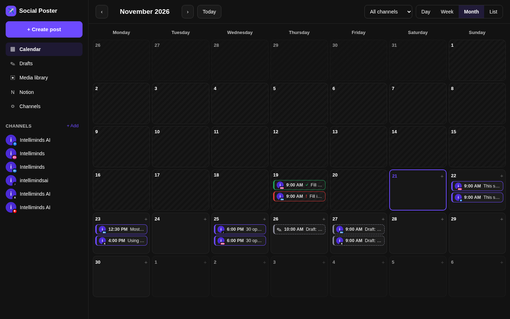
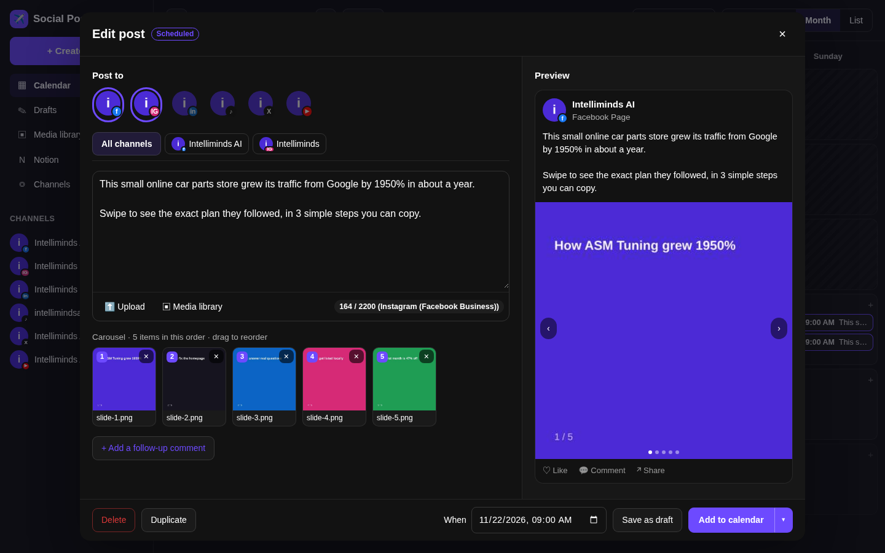
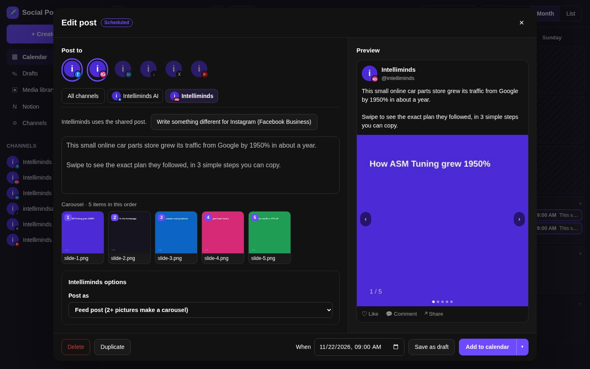
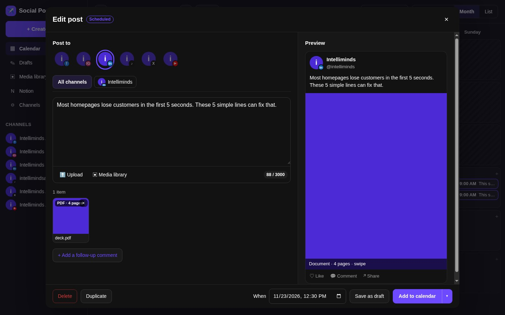
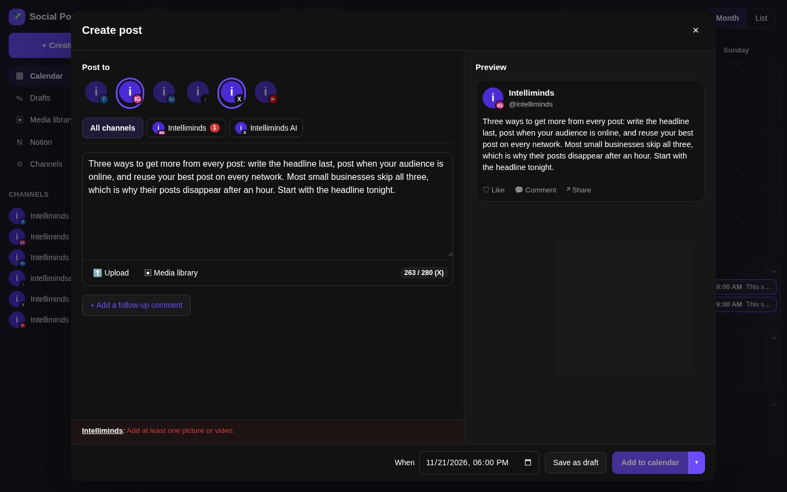
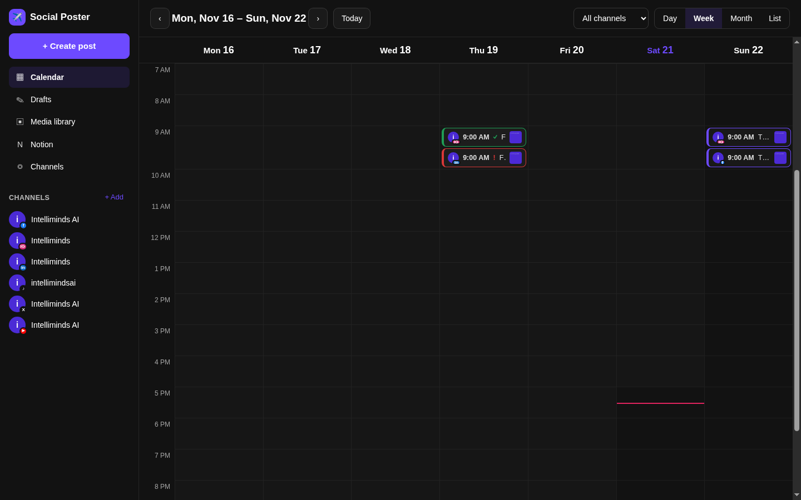
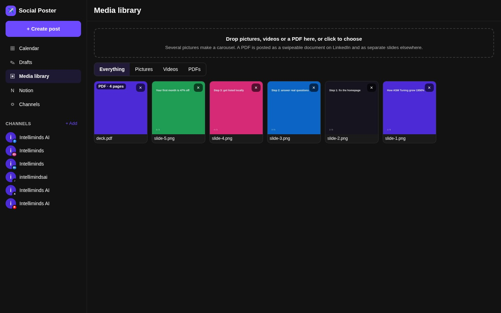
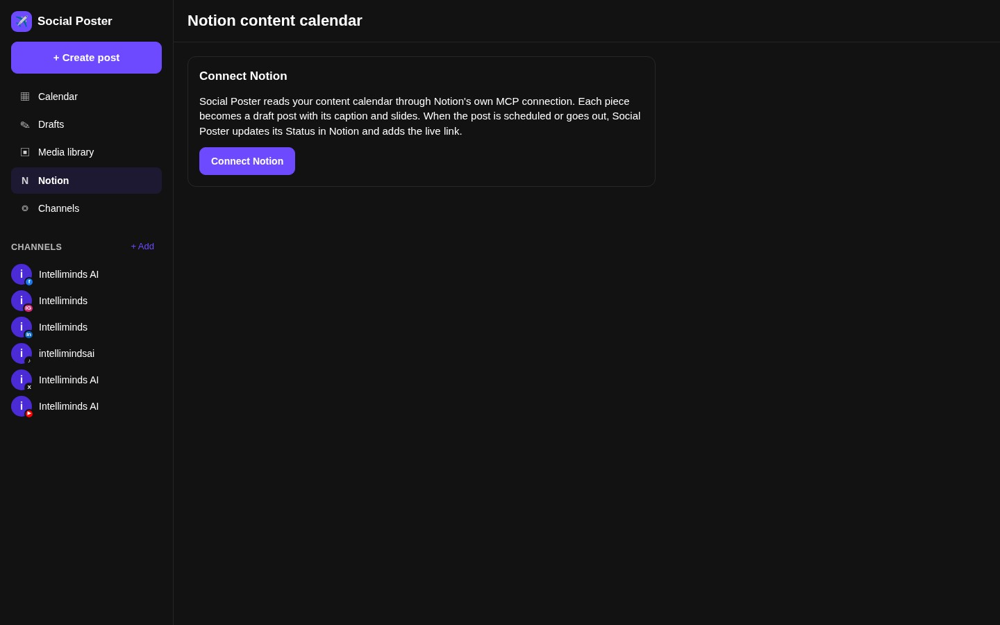
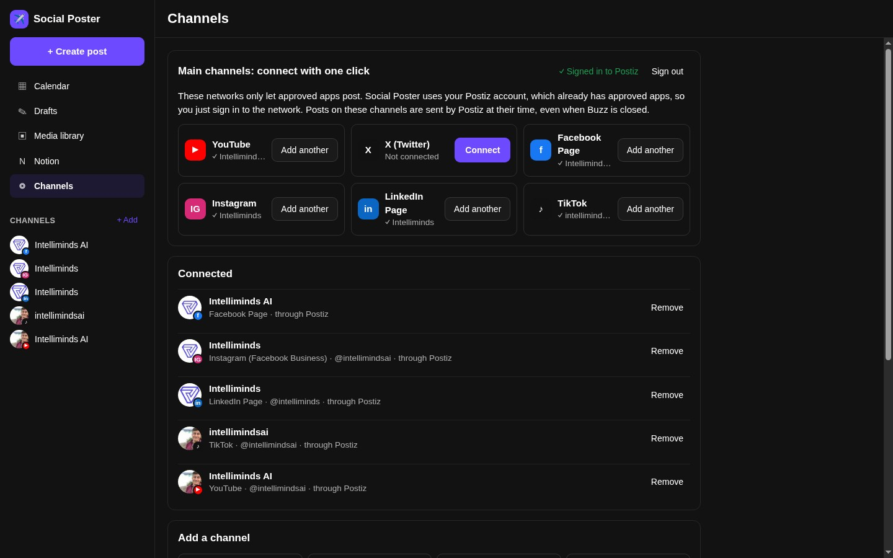

# Social Poster

Write a post once, pick the accounts, and Social Poster publishes it now or at the time you choose. It works with 34 networks, including X, LinkedIn, Instagram, Facebook, Threads, YouTube, TikTok, Pinterest, Reddit, Bluesky, Mastodon, Discord, Slack, Telegram and WordPress.

It runs the open-source [Postiz](https://github.com/gitroomhq/postiz-app) connectors on your own computer. You don't need Docker, a database server or hosting.

## Install

You need Node.js 22.5 or newer and git. Tested on Linux with Node 26.

1. Clone this repo, then build Social Poster once:
   ```sh
   git clone https://github.com/Lucas10-ctrl/Buzz-plugins.git
   cd Buzz-plugins/social-poster
   node build.mjs
   ```
   This downloads the Postiz source at a pinned commit and bundles its connectors. It also installs two commands in `~/.local/bin`: `social-poster-engine` and `social-poster`.
2. In Buzz, open **Settings → Plugins → Manage plugins**, choose **Add**, then **Browse**, and pick this `social-poster` folder. Review the access it asks for (it starts `social-poster-engine` on your computer) and choose **Install plugin**.
3. Open **Social Poster** in the sidebar.

## Use it

| Calendar | Create a post (carousel) | One channel's own version |
| --- | --- | --- |
|  |  |  |
| **PDF as a LinkedIn document** | **Problems shown before you send** | **Week view** |
|  |  |  |
| **Media library** | **Notion** | **Channels** |
|  |  |  |

- **Calendar:** day, week, month or list. Each post shows its channel, time and state (draft, scheduled, posted, needs attention). Click an empty day or hour to write a post for that time. Drag a post to another day or hour to move it.
- **Create post:** pick the channels, write once, and add pictures, a video or a PDF from your computer or the media library. Several pictures make a carousel (drag to change the order). A PDF is posted as a swipeable document on LinkedIn and as separate slides on networks that don't take PDFs. Click a channel's tab to give it its own text and pictures, and to fill in its options (for example a YouTube title or a Pinterest board). Problems such as text that is too long or too many pictures are listed before you send. You can add follow-up comments (a thread on X). The right side shows a preview.
- **Drafts:** drafts, Notion imports and posts that failed (with the reason).
- **Media library:** every picture, video and PDF you have used, stored once.
- **Notion:** connect Notion through its official MCP connection and paste the link to your content calendar database. Each piece that isn't published yet can become a draft with its caption and slides. When it is scheduled or posted, Social Poster sets its Status in Notion and fills in the live link.
- **Channels → Main channels:** YouTube, X, Facebook, Instagram, LinkedIn Page and TikTok connect with one click. These networks only let approved apps post, and approval takes weeks, so Social Poster uses your [Postiz Cloud](https://postiz.com) account, which already has approved apps. You sign in to Postiz once (if the `postiz` command is already signed in on this computer, that login is reused), then click **Connect** and sign in to the network. Channels you already connected in Postiz show up straight away. Posts for these channels are handed to Postiz with their time, so they go out even when Buzz is closed; Social Poster reads back the result and the live link. Your Postiz plan sets how many channels you can connect.
- **Channels → Add a channel:** any of the 34 networks with your own developer app. Most networks first need a free developer app that you create once. The page shows the steps and the exact callback address to paste. Bluesky, Nostr, Lemmy, Medium, Dev.to, Hashnode, WordPress and ListMonk only need your login details.

## For agents

- Buzz agents get four tools: `social_poster_accounts`, `social_poster_schedule`, `social_poster_posts` and `social_poster_cancel`.
- Any agent with a terminal can use the command line. For example:
  ```sh
  social-poster accounts
  social-poster post --to linkedin,x --text "Hello" --at 2026-11-24T09:00:00-05:00
  social-poster list --status scheduled
  ```

## Good to know

- Posts on channels connected through Postiz go out even when Buzz is closed. Other scheduled posts go out only while Buzz is open. If Buzz was closed at the scheduled time, the post goes out as soon as Buzz opens again.
- Accounts, keys and posts are stored in `~/.local/share/social-poster/` and stay on your computer.
- Instagram, Facebook, Threads, Pinterest and TikTok download pictures themselves. For files that are only on your computer, Social Poster opens a temporary public Cloudflare link that serves only those files, only while they are being posted.
- LinkedIn and Meta (Facebook, Instagram, Threads) may only accept an https callback address. If so, set a tunnel address under **Channels → Advanced settings**.

## How it works

| Postiz needs | Social Poster uses |
| --- | --- |
| Postgres, 88 tables | One SQLite file (`node:sqlite`) |
| Redis (sign-in state) | A table in that file |
| Temporal + Elasticsearch (scheduling, retries, token refresh) | A 15-second timer. Tokens are refreshed before a call and again when a network rejects one. A post interrupted mid-publish is marked failed, never re-sent blindly |
| Next.js app + NestJS API | The Buzz page (`plugin.js`), JSON lines over stdin/stdout, and a small local web server (127.0.0.1:47321) for sign-in callbacks, media and the command line |

| Path | What it is |
| --- | --- |
| `manifest.json`, `plugin.js` | The Buzz plugin: the page and the agent tools |
| `engine/main.cjs` | The engine: storage, scheduler, sign-ins, local web server |
| `engine/posts.cjs`, `engine/caps.cjs` | Posts (shared text plus per-channel versions) and what each network accepts |
| `engine/media.cjs`, `engine/tunnel.cjs` | Media library (thumbnails, PDF pages) and the temporary public link |
| `engine/cloud.cjs` | The Postiz Cloud link: sign-in, channels, handing posts over and reading results |
| `engine/notion.cjs`, `engine/notion-content.cjs` | Notion MCP sign-in and the content-calendar import and write-back |
| `engine/providers.ts` | Bundles Postiz's connectors into `engine/dist/providers.cjs` |
| `cli/social-poster.cjs` | The `social-poster` command |
| `patches/` | Changes applied to Postiz. Nostr lost the post id when a relay answered late; LinkedIn now posts a ready-made PDF as a document |
| `test/engine-e2e.mjs` | Engine over stdio. `--publish` posts a real Nostr note from a throwaway key and reads it back |
| `test/preview.mjs` | Shows the page in a normal browser against a real engine, for screenshots (`node test/preview.mjs <data folder> <port>`) |
| `test/plugin-ui.mjs` | Loads `plugin.js` in jsdom with React 19 and clicks through connecting a channel, the media library, a carousel post with a per-channel version, the calendar views, drafts and the agent tools |
| `test/postiz-cloud.mjs` | Checks the Postiz Cloud link with the Postiz account signed in on this computer: schedules a June 2027 post, moves it and deletes it. Nothing is published |
| `test/demo-seed.mjs` | Fills a throwaway data folder with example posts for screenshots |

To run the tests: `node test/engine-e2e.mjs`, then `cd test && npm ci && node plugin-ui.mjs`.

## License

AGPL-3.0, because Social Poster includes and runs Postiz code (see [LICENSE](LICENSE)). The other plugins in this repo are MIT.
